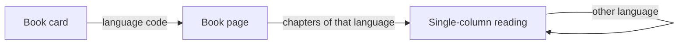

# Multiproject: reader and translator design

Design lock for one book with more than one translation. **No code, schema, or API changes in this note.** `src/` still has one project, one language pair, and one publication.

As-is, verified 2026-10-17:

- A publication is one project snapshot. `createOrUpdatePublication` upserts by `project_id`. Another target language is another project and another catalog card.
- The catalog card shows only `targetLanguage` (`PublicationCard`).
- The public chapter list is `hasTranslation` plus filters `translation=translated|all|untranslated` (`publicationRoutes.ts`, `PublicationPage`).
- Reading is one column of translated text (`ReadingMode`). The original column exists only in the author editor (`ParagraphList`).
- The translator workspace is a sidebar (chapter list, glossary, batch) plus a two-column chapter editor. Chapter status is one enum on the chapter: `pending | translating | analyzed | draft | partial | completed | error`.
- The glossary is one list per project. `translated` is the active target.
- Pipeline defaults (`TranslationPanel`): all three stages on a fresh chapter; translation + editing only when the chapter already has gaps. Batch (`ProcessChapters`) defaults to all three stages.
- MVP pairs: source `en | ko | zh` (`ru` only when the target is `be`), target `ru | be`. A second target is therefore the other of `ru` / `be`.

## Goal

The original text, chapter analysis, and the glossary entity list are shared. Translation text, chapter status, publication status, reading progress, and export belong to one target language.

The language control is a row of short codes (`RU`, `BE`), the same shape as catalog language chips. It is not a dropdown. A dropdown is only for a later world with more than two targets.

Until a project has a second language, these controls stay hidden. The workspace looks as it does today.

## Reader catalog

One book is one card in `PublicationCard`, including when both Russian and Belarusian exist.

- Replace the single language badge with a row of codes: `RU` `BE`. Hide a code until that language has at least one published chapter.
- `CatalogFilterToolbar` language chips stay as they are. A two-language book matches both `RU` and `BE`.
- The cover badge (`in_progress`, `complete`, `abandoned`, `experimental`) is the status of the language selected in the catalog filter. With "all languages", the badge is the primary translation: the language published first. The other code carries a dot: filled when that edition is `complete`, hollow while it is in progress.
- A click on the card opens the book in the filtered language. A click on a code opens the book in that language. The code is its own control (`button` or link), at least 44px on touch, with an accessible name that includes the language.

## Reader: book page and reading

On `PublicationPage`, under the title, the same `RU` | `BE` row. The selected language is the query `lang` (`?lang=be`) so a link and a reload open the same edition. Keep the existing chapter query (`q`, `translation`, `read`, `order`). Changing `lang` is an in-place refinement (`replace`), same as the other publication filters. When this ships, add `lang` to the publication and reading URL builders and to the route note in `.cursor/rules/routing.mdc` in that same change.

The table of contents and the translated / all / untranslated filters count **only the selected language**. A chapter with no text in that language stays in the list as a grey "untranslated" row and does not open the reader — the same rule as `hasTranslation === false` today. The "124 of 200" count is per language.

Reading stays one column. When the book has two languages, `ReadingMode` shows the same switch in the header. Switching to a language that does not have this chapter does not jump to another chapter. The text area becomes an empty state: this chapter is not translated yet, with a way back to the table of contents. Reading progress is stored per language.

Export and the primary read action use the selected language.

## Translator: one switch for the whole workspace

The switch sits in the sidebar under the project name (`Sidebar`): `RU` | `BE`, plus `+` when the other target is still available. The active language is the query `lang` on the project overview and on the chapter editor, so the list, the column, and the translate action still match after reload. Preserve existing `search` and `paragraph` params.

One choice updates four places:

- **Right column** in the chapter editor. The left column (original) does not change. Empty paragraphs stay empty and can still be selected for translation. An empty cell shows a short line: no translation into this language yet.
- **Chapter list and filter counts** in `ChapterList`. The row status is the translation status of the active language, not the status of the other language.
- **Glossary translation column.** Characters, locations, and terms stay one list (they came from analysis). The translation field on an entry is for the active language. An entry with no translation in that language stays visible and is marked as missing a translation.
- **Translate actions** in `TranslationPanel` and in `ProcessChapters`. Both run for the active language.

On a phone the columns already stack. The switch changes the lower block and the list in the drawer. It does not add a third column.

## Statuses on the second language

Shared analysis must not mark a chapter as finished. A chapter has two layers:

- **Analysis** is shared by the book. If analysis already exists, the chapter row shows a quiet "analysis ready" mark. That mark is not the translation status.
- **Translation of the active language** is what the list and the filters show.

On the second language, a chapter row is:

- no text — `pending` ("not translated"), even when the other language is `completed`;
- some paragraphs filled — `partial`;
- text filled, editing not finished — `draft`;
- done — `completed`;
- a job running or failed — `translating` / `error` for that language edition only.

The "analysis only" filter stays on the primary language, where `analyzed` already exists. On the second language that filter is absent: analysis is the quiet mark, and an empty chapter is "not translated".

For the reader, "has text / no text" on the selected language is still enough. The catalog cover badge is set separately for each language edition.

## Translate: analysis off when it already exists

Rule for `TranslationPanel` and `ProcessChapters`:

- If the chapter already has analysis, the Analysis checkbox is off. Translation and editing are on. The hint under the checkbox says the analysis already exists and should be turned on only to refresh it.
- If the chapter has no analysis, Analysis stays on, as it does for a new chapter today. A second language must not skip an analysis that was never run.
- Scope stays as it is: an empty chapter is the whole chapter; gaps mean empty paragraphs only.
- The one-off language-pair override on the panel and in the batch modal is not part of this flow. The project switch chooses the language, not a separate field on each run.

## Adding the second language

`+` in the sidebar opens a short modal: the remaining target allowed for this source (for an English original, the one of `ru` / `be` that is not already on the project). After confirm:

- original text and analysis stay;
- chapters in the new language are empty, and the list shows them all as not translated;
- the glossary entity list is the same, and the new language's translation column is empty;
- that language appears in the catalog only after chapters are published, as publications do today.

A second project is no longer required for a second language. This design does not merge projects that already exist as a pair. That is a separate decision, not part of these screens.
